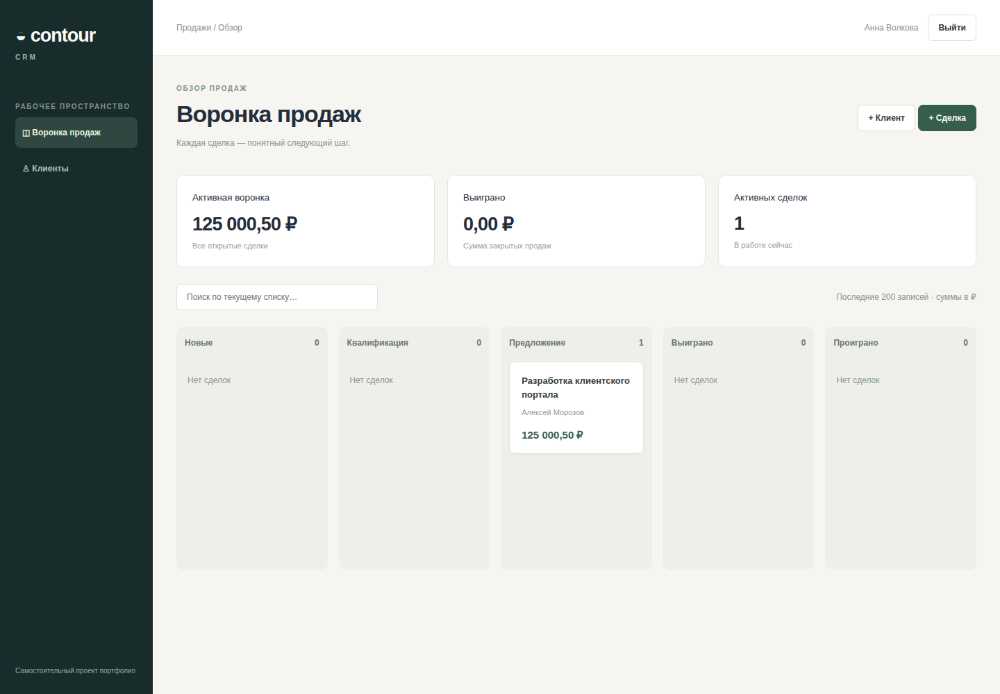
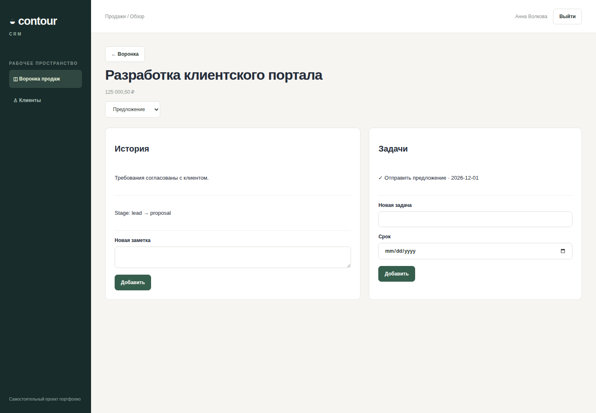

# Contour — Business CRM

Самостоятельный проект портфолио, не коммерческий опыт. Цель: клиенты, сделки, воронка продаж, задачи и аналитика. Node.js 24, SQLite, REST API и браузерный интерфейс. Бюджет 0 рублей, внешние платные услуги не используются.

Реализованы cookie-авторизация, REST API клиентов/сделок/заметок/задач, изоляция аккаунтов, целочисленные суммы в копейках, этапы сделки и транзакционная история изменений. Интерфейс Contour показывает воронку, клиентов, агрегаты продаж и карточку сделки; доступны создание заметок и задач, завершение задач и смена этапа. Списки ограничены последними 200 записями, поиск в интерфейсе работает по этому списку; агрегаты продаж считают все сделки владельца.

Локально: Node.js 24, `npm start`, открыть http://localhost:3001. Создайте аккаунт с паролем от 12 символов; затем клиента и сделку. Внешних npm-зависимостей нет. Проверка: `npm test`. Шесть автоматических тестов, Docker build, сохранение сделки после перезапуска контейнера и сценарий Chromium успешно прошли в [CI 43850465937](https://github.com/rvrhxg/business-crm/actions/runs/43850465937). Браузер проверил регистрацию, создание клиента и сделки, заметку, задачу, выполнение задачи и смену этапа. Реальные снимки desktop/mobile просмотрены визуально.

Docker: `docker compose up --build -d`. Данные сохраняются в именованном томе crm-data; сервер публикуется только на localhost:3001. Для HTTPS нужны NODE_ENV=production, точный APP_ORIGIN и TLS proxy. Не выдавайте эту разработку за production-сервис: нет команд/организаций, уведомлений, восстановления пароля и масштабируемого limiter.

Закрытые выигранные/проигранные сделки нельзя переводить обратно: для повторной продажи создаётся новая сделка. В первой версии каждый аккаунт работает со своей клиентской базой; общие команды/организации пока не поддерживаются.

Документация: [архитектура](docs/ARCHITECTURE.md), [REST API](docs/API.md), [состояние приёмки](docs/ACCEPTANCE.md).
[Демонстрационные данные и сценарий интервью](docs/DEMO.md), [эксплуатация и резервирование](docs/OPERATIONS.md).

## Скриншоты

[Мобильная версия](docs/screenshots/pipeline-mobile.png)
