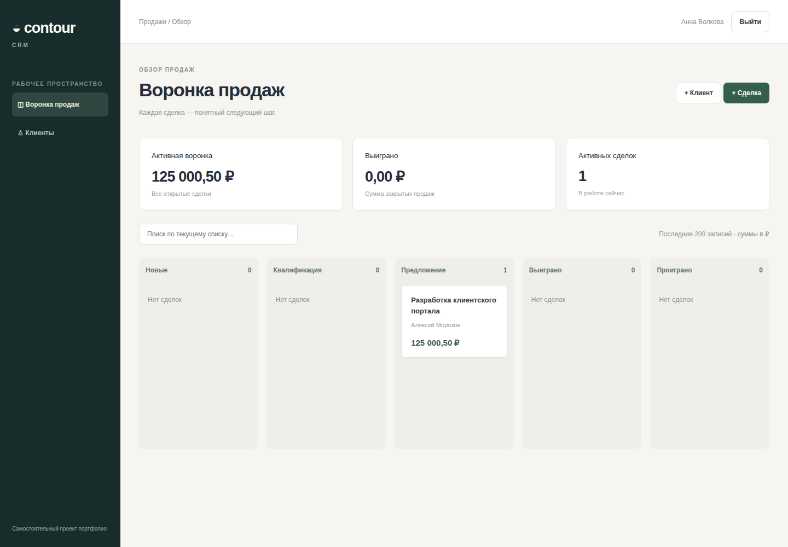

# Портфолио rvrhxg

Пять самостоятельных учебных MVP с открытым кодом. Это демонстрация инженерных решений и проверяемых сценариев, а не коммерческий опыт и не работающие production-сервисы. Публичный хостинг не подключён. Все примеры, пользователи и финансовые данные вымышлены; платные сервисы не используются.

Основные проекты для Python-резюме — Atelier Commerce, Deskline и Ledger. Relay и Contour показывают опыт fullstack-разработки на Node.js.

| Проект | Сценарий | Backend / БД | Код и запуск |
|---|---|---|---|
| Relay HelpDesk | Клиентские обращения, ответы, статусы, роли, аудит | Node.js 24 / SQLite | [Репозиторий](https://github.com/rvrhxg/-helpdesk-system) · [README](https://github.com/rvrhxg/-helpdesk-system#readme) |
| Contour CRM | Клиенты, сделки, этапы воронки, задачи и заметки | Node.js 24 / SQLite | [Репозиторий](https://github.com/rvrhxg/business-crm) · [README](https://github.com/rvrhxg/business-crm#readme) |
| Atelier Commerce | Каталог, корзина, транзакционное оформление, история заказов | Python / FastAPI / SQLAlchemy / Alembic / PostgreSQL | [Репозиторий](https://github.com/rvrhxg/E-commerce-Platform) · [README](https://github.com/rvrhxg/E-commerce-Platform#readme) |
| Deskline Business Bot | Запись через команды Telegram и управление расписанием | Python / aiogram / FastAPI / SQLite | [Репозиторий](https://github.com/rvrhxg/Telegram-Business-Bot) · [README](https://github.com/rvrhxg/Telegram-Business-Bot#readme) |
| Ledger Finance | Операции, аналитика по периодам, бюджеты и идемпотентный CSV-импорт | Python / FastAPI / pandas / SQLAlchemy / PostgreSQL | [Репозиторий](https://github.com/rvrhxg/Finance-Dashboard) · [README](https://github.com/rvrhxg/Finance-Dashboard#readme) |

## Скриншоты настоящего интерфейса

Снимки получены браузерными сценариями CI; это не макеты. Дополнительные мобильные экраны находятся в `docs/screenshots` каждого репозитория.

### Relay

### Contour

### Atelier

### Deskline

Симуляция обработчиков команд не означает проверенную доставку Telegram.

### Ledger

## Как запустить

Каждый репозиторий самостоятелен: клонируйте нужный и выполняйте команды из его корня. Для Python создайте отдельное окружение (`python -m venv .venv`), активируйте его и установите `python -m pip install -r requirements.lock`. Для Windows можно вызывать `.venv\Scripts\python.exe` напрямую; для Linux/macOS — `.venv/bin/python`. Python 3.12–3.14 проверяются в CI, Docker использует 3.14. Локальные быстрые сценарии Python используют SQLite; Commerce и Finance в Docker — PostgreSQL.

| Проект | Подготовка и локальный запуск | Адрес | Тесты |
|---|---|---|---|
| Relay | `npm start`, зарегистрироваться; сотрудник создаётся отдельной CLI из README | http://localhost:3000 | `npm test` |
| Contour | `npm start`, зарегистрироваться | http://localhost:3001 | `npm test` |
| Atelier | `python -m alembic upgrade head`, `python -m app.seed --catalog`, `uvicorn app.main:create_app --factory --host 127.0.0.1 --port 8000` | http://localhost:8000 | `pytest -q` |
| Deskline | `python -m app.setup --admin-email admin@example.test --demo`, команда сервера — ниже | http://localhost:8001 | `pytest -q` |
| Ledger | `python -m app.seed --email demo@example.test`, команда сервера — ниже | http://localhost:8002 | `pytest -q` |

Для Deskline: `uvicorn app.api:create_app --factory --host 127.0.0.1 --port 8001`. Для Ledger: `uvicorn app.main:create_app --factory --host 127.0.0.1 --port 8002`. Перед запуском установите APP_ORIGIN соответственно `http://localhost:8001` или `http://localhost:8002` (PowerShell: `$env:APP_ORIGIN='http://localhost:8002'`, POSIX: `export APP_ORIGIN=http://localhost:8002`). Seed запрашивает пароль локально через getpass; встроенных общих паролей нет. Не запускайте seed повторно поверх существующих данных.

Для Docker нужен Docker Engine/Desktop и Compose. В Commerce и Ledger сначала создайте исключённый из Git `.env` с собственным POSTGRES_PASSWORD по README. Затем в выбранном репозитории: `docker compose up --build -d`. Seed выполняется внутри соответствующего контейнера (`store`, `dashboard`), инструкции — в README. `docker compose down` останавливает проект; не используйте `down -v`, если хотите сохранить данные. Commerce и HelpDesk занимают разные порты, но несколько копий одного проекта требуют перенастройки.

Deskline по умолчанию запускает только панель. Реальный бот включается отдельным профилем с BOT_TOKEN, заданным локально. Токен не публикуется в коде, README, логах и чате. Живые polling и доставка Telegram не проверены; тесты проходят через настоящий aiogram Dispatcher с перехватом транспортного слоя.

## Что проверено и где смотреть доказательства

В каждом репозитории есть `.github/workflows/ci.yml`, `tests`/`test`, `docs/ARCHITECTURE.md` и `docs/ACCEPTANCE.md`. Последние результаты совместимости указываются в приёмке соответствующего Python-проекта. Зелёный CI подтверждает только перечисленные сценарии на указанном коммите.

| Python-проект | Подтверждённый CI | Результат |
|---|---|---|
| Atelier | [43909675515](https://github.com/rvrhxg/E-commerce-Platform/actions/runs/43909675515), 74e59f5 | Python 3.12/3.13/3.14; миграции, авторизация, PostgreSQL-гонка, Docker и Chromium с переходами страниц |
| Deskline | [43909764342](https://github.com/rvrhxg/Telegram-Business-Bot/actions/runs/43909764342), 6b4d66d | Python 3.12/3.13/3.14; 10 тестов, включая гонку пересекающихся записей, Docker и Chromium |
| Ledger | [43909831110](https://github.com/rvrhxg/Finance-Dashboard/actions/runs/43909831110), 9edf48f | Python 3.12/3.13/3.14; 7 тестов, Docker/PostgreSQL и Chromium |

Матрица совместимости запускает тесты с SQLite; контейнерные и PostgreSQL-сценарии выполняются отдельным job на Python 3.14. После этих коммитов могут следовать изменения документации с записью результатов.

Relay: роли и обращения, HTTP-защита, Docker restart/persistence и Chromium. Contour: владение клиентами/сделками, бизнес-правила стадий и задач, Docker restart/persistence и Chromium. Atelier: точные суммы, снимки цен, rollback нескольких товаров, повтор заказа, PostgreSQL-гонка за последнюю единицу, миграции, роли/сессии и страницы. Deskline: повтор update_id, чужая отмена, пересечения интервалов и конкурентная запись, admin REST и контейнерная панель. Ledger: точные суммы, владельцы, периоды, pandas-агрегации, атомарный повторяемый CSV-импорт, бюджеты и сохранность после перезапуска PostgreSQL.

Локально установлен Python 3.14; Docker и браузерные проверки выполнялись в Linux CI. Нагрузочные испытания, внешний аудит безопасности, восстановление резервной копии в аварии, реальная оплата, банковские интеграции и Telegram-доставка в проверенную область не входят. Есть ограниченный in-memory limiter; нет восстановления пароля и полной production-наблюдаемости. Offset-пагинация Atelier может сдвигаться при конкурентных вставках, списки Contour и Ledger имеют документированные лимиты.
